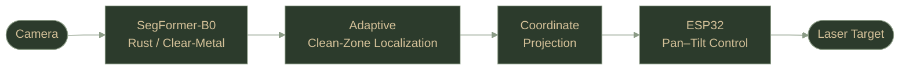

<picture>
  <source media="(prefers-color-scheme: dark)" srcset="assets/header-dark.svg">
  <source media="(prefers-color-scheme: light)" srcset="assets/header-light.svg">
  
</picture>

 

### யாதும் ஊரே யாவரும் கேளிர்

<i>Every place is our home; everyone is our kin.</i>
 
— Kaniyan Poongundranar · <i>Purananuru</i>

 

  

 

<table>
<tr>
<td align="center" width="25%"><h3>2</h3>PATENTS</td>
<td align="center" width="25%"><h3>2</h3>RESEARCH WORKS</td>
<td align="center" width="25%"><h3>5</h3>INTERNSHIPS</td>
<td align="center" width="25%"><h3>5</h3>LEADERSHIP ROLES</td>
</tr>
</table>

 

<table width="100%">
<tr>
<td width="140" align="center" valign="top">
<!-- To use your real photo: save it as assets/profile.jpg (square, cropped round) and change the src below -->

</td>
<td valign="top">

I am a **Computer Science &amp; Engineering undergraduate** and the **Founder of Kuralara WebFlux**, focused on **Applied AI, Deep Learning, Computer Vision, and intelligent systems**.

My work sits between **research and engineering** — combining experimentation, mathematical and statistical analysis, machine learning, software development, and embedded systems. My railway inspection research has reached a **published patent**, and I serve as **Technical &amp; Research Lead** of the AAAI Student Chapter at SRMIST.

</td>
</tr>
</table>

**Understand&nbsp; → &nbsp;Investigate&nbsp; → &nbsp;Experiment&nbsp; → &nbsp;Evaluate&nbsp; → &nbsp;Engineer**

 

`Deep Learning`&nbsp;&nbsp;`Computer Vision`&nbsp;&nbsp;`Medical AI`&nbsp;&nbsp;`Edge AI`&nbsp;&nbsp;`Time-Series Analysis`

 

<i>B.Tech. Computer Science &amp; Engineering · SRM Institute of Science &amp; Technology · 2024 – 2028 · Tiruchirappalli, Tamil Nadu, India</i>

 

<picture>
  <source media="(prefers-color-scheme: dark)" srcset="assets/divider-dark.svg">
  <source media="(prefers-color-scheme: light)" srcset="assets/divider-light.svg">
  
</picture>

## Patents

<i>Research carried through to intellectual property</i>

 

<table width="100%">
<tr><th align="left">Invention</th><th align="right">Status</th></tr>
<tr>
<td><b>Vision-Guided Laser QR Encoding for Railway Track Components</b> Computer Vision · Embedded AI</td>
<td align="right"></td>
</tr>
<tr>
<td><b>NovaShield AI</b> — Autonomous Cybersecurity Framework AI Threat Detection · Zero Trust</td>
<td align="right"></td>
</tr>
</table>

 

## Research

<i>Selected investigation — expand for detail</i>

 

<b>&nbsp;Power Grid Inertia Prediction &amp; Estimation</b> · Research Intern, NIT Puducherry · Dec 2025

 

Conducted individual research on **power-grid inertia prediction and estimation** using frequency time-series data.

| Track | Detail |
|:--|:--|
| Signal Processing | ROCOF extraction, Savitzky–Golay filtering, frequency time-series analysis |
| Deep Learning | LSTM · GRU · BiLSTM, multi-step prediction |
| Research Direction | Physics-guided estimation via the **Swing Equation**, alongside data-driven deep learning |

<!-- Add a result plot: save as assets/inertia-prediction.png, then uncomment

-->

`Time-Series Analysis` `Signal Processing` `Deep Learning`

<b>&nbsp;AI-Enabled Wearable System for Chronic Disease Monitoring</b> · Independent Research · Manuscript Complete

 

Designed an AI-enabled framework for **continuous physiological monitoring and health-risk assessment**.

| Prediction &amp; Sensing | Learning &amp; Trust |
|:--|:--|
| Physiological trend prediction | Personalized AI |
| Early-warning systems | Federated learning |
| Multimodal sensing | Explainable AI |
| Edge–cloud collaboration | Privacy-preserving learning |

`Medical AI` `Edge AI` `Federated Learning` `Explainable AI`

 

## Selected Systems

<i>Research translated into engineered systems</i>

 

<b>&nbsp;I. Vision-Guided Laser QR Encoding for Railway Track Components</b> · Patent Published

 

Developed a railway inspection prototype combining **semantic segmentation, clean-zone localization, coordinate projection, and embedded laser control** — protected by a **published patent**.

| Evaluation | Result |
|:--|--:|
| Clear-Metal IoU | **0.78** |
| Rust IoU | **0.74** |
| Laser Targeting Error @ 35 cm | **≈ 2.1 mm** |
| Custom Dataset | **112 images** |

<!-- Add visuals: save as assets/railway-segmentation.png (and/or assets/laser-demo.gif), then uncomment

-->

&nbsp;
`Computer Vision` `Semantic Segmentation` `Embedded AI`

<b>&nbsp;II. Tuberculosis Detection System Using Deep CNNs</b> · Medical AI · MobileNetV2

 

Developed an automated pulmonary tuberculosis detection system from chest X-ray images using **MobileNetV2**, integrated into a Flask-based application.

| Evaluation Metric | Result |
|:--|--:|
| Accuracy | **94.2%** |
| Sensitivity | **92.8%** |
| AUC | **0.967** |

**Interpretability** — Cavity detection · Pleural-effusion assessment · Anatomical-zone analysis

<!-- Add a Grad-CAM heatmap: save as assets/tb-gradcam.png, then uncomment

-->

`Medical AI` `Deep Learning` `Computer Vision` `Explainable AI`

<b>&nbsp;III. NovaShield AI</b> · Patent Filed

 

Designed an autonomous cybersecurity framework for anomalous system and log-activity detection.

**Core Directions** — Anomaly Detection · AI Threat Detection · Automated Response · Zero Trust · Cloud Security

&nbsp;
`AI Threat Detection` `Zero Trust` `Cloud Security`

 

## Public Project

<picture>
  <source media="(prefers-color-scheme: dark)" srcset="https://github-readme-stats.vercel.app/api/pin/?username=Kurinji-Eswar&repo=WelfareSync&hide_border=true&bg_color=1A2419&title_color=D4C199&icon_color=D4C199&text_color=9BAA96">
  <source media="(prefers-color-scheme: light)" srcset="https://github-readme-stats.vercel.app/api/pin/?username=Kurinji-Eswar&repo=WelfareSync&hide_border=true&bg_color=F4F0E3&title_color=5C6B4F&icon_color=8C7A45&text_color=3A4A3A">
  
</picture>

<i>Multi-Tenant Resident Welfare Analytics &amp; Monitoring System</i>
 
`Node.js` · `PostgreSQL` · `MongoDB` · `Redis` · Multi-Tenant Architecture · REST APIs · Event-Driven Architecture

  

## Founder

### Kuralara WebFlux

<i>Founded 2025 · Building digital products and web solutions</i>
 
<a href="https://kuralarawebflux.com"><b>Visit Kuralara WebFlux →</b></a>

 

<picture>
  <source media="(prefers-color-scheme: dark)" srcset="assets/divider-dark.svg">
  <source media="(prefers-color-scheme: light)" srcset="assets/divider-light.svg">
  
</picture>

## Experience

<i>Research, data science, and software engineering</i>

 

<table width="100%">
<tr>
<td><b>Research Intern</b> · NIT Puducherry Power-grid inertia prediction and estimation using frequency time-series data, signal processing, and deep-learning models.</td>
<td align="right" valign="top">Dec 2025</td>
</tr>
<tr>
<td><b>Full Stack Web Development Intern</b> · Axcentra Full-stack applications using the MERN stack and REST APIs; development, debugging, and performance improvements.</td>
<td align="right" valign="top">Dec 2025 – Jan 2026</td>
</tr>
<tr>
<td><b>Data Science Intern</b> · Prodigy InfoTech Python, Pandas, Scikit-learn, data preprocessing, feature engineering, and machine-learning prototypes.</td>
<td align="right" valign="top">Jun – Jul 2025</td>
</tr>
<tr>
<td><b>Python Full Stack Intern</b> · EduSkills Foundation Python-based applications with hands-on practice in databases, programming, and software development.</td>
<td align="right" valign="top">Jan – Mar 2025</td>
</tr>
<tr>
<td><b>Web Development Intern</b> · Prodigy InfoTech Responsive web interfaces using HTML, CSS, and JavaScript, with emphasis on modular and reusable development.</td>
<td align="right" valign="top">Jan – Feb 2025</td>
</tr>
</table>

 

## Leadership &amp; Contributions

 

<table width="100%">
<tr><td><b>Founder</b> · Kuralara WebFlux</td><td align="right">2025 – Present</td></tr>
<tr><td><b>Technical &amp; Research Lead</b> · AAAI Student Chapter, SRMIST</td><td align="right">2026 – Present</td></tr>
<tr><td><b>Student Coordinator</b> · Student Editorial Board, CSE</td><td align="right">2026 – Present</td></tr>
<tr><td><b>Global Contributor</b> · Open Source Connect</td><td align="right">2025 – Present</td></tr>
<tr><td><b>Accounts Coordinator</b> · Entrepreneurship Development Cell, SRMIST</td><td align="right">2024 – 2025</td></tr>
</table>

 

## Technology

<picture>
  <source media="(prefers-color-scheme: dark)" srcset="https://skillicons.dev/icons?i=python,pytorch,tensorflow,opencv,sklearn,cpp,java,js,nodejs,postgres,mongodb,redis,docker,aws,git,github&perline=8&theme=dark">
  <source media="(prefers-color-scheme: light)" srcset="https://skillicons.dev/icons?i=python,pytorch,tensorflow,opencv,sklearn,cpp,java,js,nodejs,postgres,mongodb,redis,docker,aws,git,github&perline=8&theme=light">
  
</picture>

 

| Area | Focus |
|:--|:--|
| **Artificial Intelligence** | Deep Learning · CNNs · Computer Vision · Semantic Segmentation · Explainable AI · Medical AI · Time-Series Analysis · Signal Processing · Feature Engineering |
| **Software Engineering** | Python · C++ · Java · JavaScript · SQL · Flask · Node.js · REST APIs · Full-Stack Development · OOP · Data Structures &amp; Algorithms |
| **Data &amp; Infrastructure** | PostgreSQL · MongoDB · MySQL · SQLite · Redis · Docker · AWS · ESP32 |

 

<picture>
  <source media="(prefers-color-scheme: dark)" srcset="assets/divider-dark.svg">
  <source media="(prefers-color-scheme: light)" srcset="assets/divider-light.svg">
  
</picture>

## More About Me

<i>Expand a section for details</i>

 

<b>&nbsp;Certifications</b> · 4

 

- **Python Programming — Beginner to Advanced** · GUVI / HCL · Google for Education Partner
- **Python Developer Certification** · freeCodeCamp
- **Foundations of Positive Psychology** · Five-Course Specialization
- **Agentic AI Workshop** · KAMALA AI Program

<b>&nbsp;Technical Activities</b> · Varnam '26

 

- **AI No-Code Connect** · Varnam '26
- **Slide Pitch / Paper Presentation** · Varnam '26
- **Supercharging CRM with AI** · Varnam '26

<b>&nbsp;Distinctions &amp; Beyond Computing</b> · Bharatanatyam · Yoga · Kung Fu

 

- **Kalai Ilamani Award** · Government of Tamil Nadu · *Bharatanatyam*
- **State-Level Kala Utsav** · Third Place · *Bharatanatyam*
- Multiple medals across Bharatanatyam, Yoga, and Kung Fu

*Classical practice has shaped the qualities I bring to engineering: precision, patience, consistency, and discipline.*

 

## GitHub Activity

 

<picture>
  <source media="(prefers-color-scheme: dark)" srcset="https://github-readme-stats.vercel.app/api?username=Kurinji-Eswar&show_icons=true&hide_border=true&bg_color=1A2419&title_color=D4C199&icon_color=D4C199&text_color=9BAA96&ring_color=D4C199">
  <source media="(prefers-color-scheme: light)" srcset="https://github-readme-stats.vercel.app/api?username=Kurinji-Eswar&show_icons=true&hide_border=true&bg_color=F4F0E3&title_color=5C6B4F&icon_color=8C7A45&text_color=3A4A3A&ring_color=8C7A45">
  
</picture>
<picture>
  <source media="(prefers-color-scheme: dark)" srcset="https://github-readme-stats.vercel.app/api/top-langs/?username=Kurinji-Eswar&layout=compact&hide_border=true&bg_color=1A2419&title_color=D4C199&text_color=9BAA96">
  <source media="(prefers-color-scheme: light)" srcset="https://github-readme-stats.vercel.app/api/top-langs/?username=Kurinji-Eswar&layout=compact&hide_border=true&bg_color=F4F0E3&title_color=5C6B4F&text_color=3A4A3A">
  
</picture>

  

### அறிவு &nbsp;·&nbsp; ஆய்வு &nbsp;·&nbsp; ஆக்கம்
<i>Knowledge · Research · Creation</i>

 

<a href="https://github.com/Kurinji-Eswar">GitHub</a> &nbsp;·&nbsp;
<a href="https://linkedin.com/in/kurinji-eswar">LinkedIn</a> &nbsp;·&nbsp;
<a href="https://kuralarawebflux.com">Kuralara WebFlux</a> &nbsp;·&nbsp;
<a href="https://x.com/Kurinji_Offl">X</a> &nbsp;·&nbsp;
<a href="mailto:kurinjieswarofficial@gmail.com">Email</a>

  

<picture>
  <source media="(prefers-color-scheme: dark)" srcset="assets/footer-dark.svg">
  <source media="(prefers-color-scheme: light)" srcset="assets/footer-light.svg">
  
</picture>

© Kurinji Eswar J A

